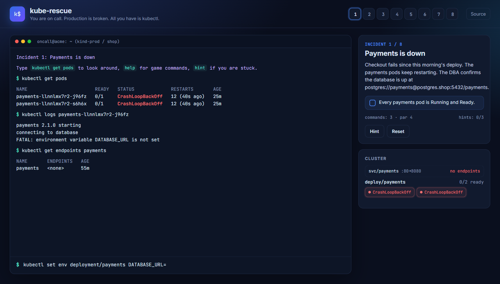
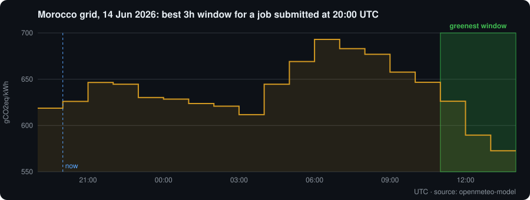
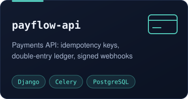
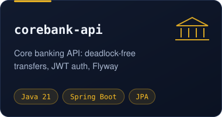
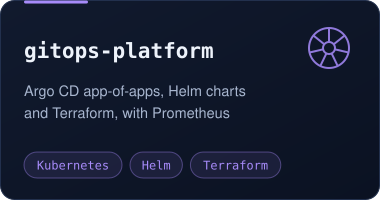

I build and run backend services on Kubernetes, and I like the parts that decide whether
they survive production.

- Computer engineering graduate from **EHTP** (2026), looking for a junior **DevOps** or **backend** role in Morocco
- Final-year project: a software **payment HSM** in C and OpenSSL (PIN blocks, key hierarchy under an LMK)
- Comfortable with Kubernetes, Helm, Argo CD, Terraform, CI/CD, Prometheus, Python and Java
- Every project below has tests, CI and a README that explains the design choices

**[▶ Play kube-rescue in your browser](https://schaib03.github.io/kube-rescue/)**, a game where you fix broken Kubernetes clusters with kubectl.

---

<table>
  <tr>
    <td width="50%" valign="top">
      
      <h3><a href="https://github.com/Schaib03/kube-rescue">kube-rescue</a></h3>
      Eight production incidents to fix with <code>kubectl</code>: CrashLoopBackOff, OOMKilled,
      bad rollouts, Services without endpoints, failing probes, Pending pods. A simulated
      cluster in plain TypeScript, every level covered by tests, deployed on GitHub Pages.
        
      <a href="https://schaib03.github.io/kube-rescue/"><b>Play it</b></a> · <a href="https://github.com/Schaib03/kube-rescue">Code</a>
    </td>
    <td width="50%" valign="top">
      
      <h3><a href="https://github.com/Schaib03/greenwindow">greenwindow</a></h3>
      A Kubernetes operator that holds flexible batch jobs until the electricity grid is
      cleanest. Morocco has no public hourly carbon data, so it estimates it from weather
      forecasts at Noor Ouarzazate and three wind farms. Python, kopf, a CRD, Helm, and an
      end-to-end test on a real kind cluster in CI.
        
      <a href="https://github.com/Schaib03/greenwindow"><b>Code and docs</b></a>
    </td>
  </tr>
</table>

  
  
  

---

  
  
  
  
  
  
  
  
  
  
  
  
  
  
  
  

